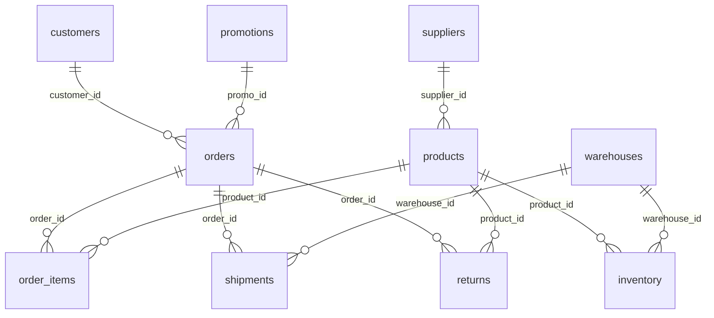

# Fiction Retail SQLite Schema Reference

**Release:** `fiction-retail-agent-dataset-v2` on branch `data/fiction-course-v0.3`. This reference was checked against `data/fiction-retail.db` and `data/fiction_runtime_v04.sqlite`. Row counts describe this released snapshot, not a live service. Both databases contain fictional data. See [AGENT_DATASET.md](AGENT_DATASET.md) for read-only connection examples and [DATA_CONTRACT.md](DATA_CONTRACT.md) for provenance and date limits.

## Database boundaries

| SQLite file | Attach alias | Tables | Ownership |
|---|---|---:|---|
| `data/fiction-retail.db` | `source` | 10 | Unchanged [DataHub source](https://github.com/datahub-project/static-assets/blob/main/datasets/fiction-retail/README.md) |
| `data/fiction_runtime_v04.sqlite` | `extension` | 17 | Synthetic scenarios, dated catalog values, and guide index authored in this repository |

The source tables have **no declared SQLite primary or foreign keys**. Their ID columns are logical keys: each of the ten table ID columns was unique in this release. The extension declares primary keys and internal foreign keys for selected relationships. SQLite does not declare cross-database foreign keys between `extension` and `source`; use the joins listed below and validate IDs when importing a different source file.



The diagram shows logical source joins, not enforced constraints. A return names an order and product, but the source has no `order_item_id` on a return, so a precise returned line cannot always be inferred from that pair alone.

## Source tables

The `ID` column in each row below is unique in the released data but not a declared SQLite primary key. Types are the actual SQLite declarations, not the upstream README's generalized type descriptions.

| Table (rows) | Grain and logical key | Columns and SQLite types |
|---|---|---|
| `customers` (50,000) | One customer; `customer_id` | `customer_id TEXT`, `name TEXT`, `email TEXT`, `phone TEXT`, `signup_date TEXT`, `country TEXT`, `state TEXT`, `city TEXT`, `customer_segment TEXT` |
| `orders` (150,000) | One order; `order_id` | `order_id TEXT`, `customer_id TEXT`, `order_date TEXT`, `order_status TEXT`, `total_amount REAL`, `payment_method TEXT`, `shipping_country TEXT`, `promo_id TEXT` |
| `order_items` (346,202) | One order line; `order_item_id` | `order_item_id TEXT`, `order_id TEXT`, `product_id TEXT`, `quantity INTEGER`, `unit_price REAL`, `discount_pct INTEGER` |
| `products` (5,000) | One imported product; `product_id` | `product_id TEXT`, `name TEXT`, `category TEXT`, `brand TEXT`, `price REAL`, `weight_kg REAL`, `supplier_id TEXT` |
| `suppliers` (500) | One supplier; `supplier_id` | `supplier_id TEXT`, `name TEXT`, `country TEXT`, `contract_start_date TEXT`, `status TEXT` |
| `inventory` (11,476) | One product/warehouse stock row; `inventory_id` | `inventory_id TEXT`, `product_id TEXT`, `warehouse_id TEXT`, `quantity_on_hand INTEGER`, `reserved_quantity INTEGER`, `reorder_threshold INTEGER`, `last_restocked_date TEXT` |
| `warehouses` (15) | One warehouse; `warehouse_id` | `warehouse_id TEXT`, `name TEXT`, `city TEXT`, `state TEXT`, `country TEXT`, `capacity_units INTEGER`, `opened_date TEXT` |
| `shipments` (119,936) | One shipment; `shipment_id` | `shipment_id TEXT`, `order_id TEXT`, `warehouse_id TEXT`, `carrier TEXT`, `tracking_number TEXT`, `shipped_date TEXT`, `delivered_date TEXT`, `shipment_state TEXT` |
| `returns` (11,934) | One return record; `return_id` | `return_id TEXT`, `order_id TEXT`, `product_id TEXT`, `return_date TEXT`, `refund_amount REAL`, `return_reason_code TEXT`, `processed_by TEXT` |
| `promotions` (200) | One promotion; `promo_id` | `promo_id TEXT`, `promo_code TEXT`, `description TEXT`, `discount_pct INTEGER`, `valid_from TEXT`, `valid_until TEXT`, `applies_to_category TEXT`, `max_uses INTEGER`, `status TEXT` |

### Source field meanings that affect queries

- `orders.order_date`, `shipments.shipped_date`, `shipments.delivered_date`, and `returns.return_date` are text dates. Source order dates span 2023-01-01 through 2024-04-30.
- `orders.total_amount` is recorded USD order value. It matches the sum of `order_items.quantity * unit_price * (1 - discount_pct / 100.0)` within USD 0.02 for all 150,000 orders in this snapshot. It does not prove payment settlement.
- `order_items.discount_pct` and `promotions.discount_pct` are integer percentage points, not fractions. `order_items.unit_price` is the historical transaction price.
- `products.price` and `products.weight_kg` are undated import fields. The imported product names are often not credible merchandise descriptions. Do not infer current offers or product specifications from them.
- `inventory.quantity_on_hand - inventory.reserved_quantity` is a stock calculation, but the table lacks an observation timestamp. `last_restocked_date` is **not** a snapshot timestamp.
- `returns.refund_amount` is a recorded amount, not proof that a refund was approved or paid. `shipments` has no promised delivery date, so the schema cannot establish on-time delivery.
- `customers.name`, `email`, and `phone` are fictional but still personal-data-shaped fields. Customer rows are excluded from the RAG corpus.

## Extension tables

The extension's `provenance` fields mark scenario-generated records. All extension row counts and columns below were read from the v0.4 SQLite file.

| Table (rows) | Grain / declared key | Columns and SQLite types |
|---|---|---|
| `teams` (4) | One sales team; PK `team_id` | `team_id TEXT`, `name TEXT` |
| `employees` (24) | One synthetic advisor; PK `employee_id` | `employee_id TEXT`, `team_id TEXT`, `display_name TEXT`, `role TEXT`, `hire_date TEXT`, `active INTEGER` |
| `sales_opportunities` (564) | One synthetic opportunity; PK `opportunity_id` | `opportunity_id TEXT`, `employee_id TEXT`, `customer_id TEXT`, `order_id TEXT`, `opened_at TEXT`, `closed_at TEXT`, `status TEXT`, `provenance TEXT` |
| `sales_activities` (1,008) | One synthetic activity; PK `activity_id` | `activity_id TEXT`, `opportunity_id TEXT`, `employee_id TEXT`, `occurred_at TEXT`, `activity_type TEXT`, `outcome TEXT`, `provenance TEXT` |
| `sales_targets` (24) | Advisor/month/metric target; composite PK (`employee_id`, `month`, `metric_key`) | `employee_id TEXT`, `month TEXT`, `metric_key TEXT`, `target_value_usd TEXT`, `provenance TEXT` |
| `fulfillment_cases` (100) | One selected backorder investigation; PK `case_id` | `case_id TEXT`, `order_id TEXT`, `order_item_id TEXT`, `product_id TEXT`, `request_qty INTEGER`, `assigned_warehouse_id TEXT`, `case_date TEXT`, `provenance TEXT` |
| `fulfillment_events` (200) | One legacy case event; PK `event_id` | `event_id TEXT`, `case_id TEXT`, `event_time TEXT`, `event_type TEXT`, `provenance TEXT` |
| `inventory_observations` (126) | One legacy case observation; PK `observation_id` | `observation_id TEXT`, `case_id TEXT`, `product_id TEXT`, `warehouse_id TEXT`, `observed_at TEXT`, `on_hand INTEGER`, `reserved INTEGER`, `provenance TEXT` |
| `warehouse_eligibility` (200) | One case/warehouse rule; composite PK (`case_id`, `warehouse_id`) | `case_id TEXT`, `warehouse_id TEXT`, `eligible INTEGER`, `reason_code TEXT`, `provenance TEXT` |
| `fulfillment_policies` (1) | One warehouse-policy index row; PK `policy_id` | `policy_id TEXT`, `policy_summary TEXT`, `requires_manager_approval INTEGER`, `provenance TEXT` |
| `operational_events` (400) | One timestamped case event; PK `event_id` | `event_id TEXT`, `case_id TEXT`, `event_type TEXT`, `occurred_at TEXT`, `recorded_at TEXT`, `source_system TEXT`, `provenance TEXT` |
| `inventory_snapshots_v2` (216) | One timestamped case/warehouse/product snapshot; PK `snapshot_id` | `snapshot_id TEXT`, `case_id TEXT`, `product_id TEXT`, `warehouse_id TEXT`, `observed_at TEXT`, `received_at TEXT`, `on_hand INTEGER`, `reserved INTEGER`, `source_system TEXT`, `provenance TEXT` |
| `inventory_movements_v2` (22) | One case-scoped stock movement; PK `movement_id` | `movement_id TEXT`, `case_id TEXT`, `product_id TEXT`, `warehouse_id TEXT`, `occurred_at TEXT`, `delta_on_hand INTEGER`, `delta_reserved INTEGER`, `reason TEXT`, `provenance TEXT` |
| `product_enrichment` (50) | One curated product; PK `product_id` | `product_id TEXT`, `source_name TEXT`, `category TEXT`, `synthetic_display_name TEXT`, `product_type TEXT`, `synthetic_specs TEXT`, `compatibility_note TEXT`, `provenance TEXT`, `curated_list_price_usd TEXT`, `curated_shipping_weight_kg TEXT`, `catalog_effective_from TEXT`, `catalog_effective_to TEXT` |
| `product_pricing_constraints` (20) | One dated product price rule; PK `product_id` | `product_id TEXT`, `unit_cost_usd TEXT`, `min_margin_bps INTEGER`, `max_discount_bps INTEGER`, `effective_from TEXT`, `effective_to TEXT`, `policy_id TEXT`, `provenance TEXT` |
| `knowledge_documents` (5,003) | One Markdown document; PK `document_id` | `document_id TEXT`, `product_id TEXT`, `policy_id TEXT`, `kind TEXT`, `relative_path TEXT`, `sha256 TEXT`, `provenance TEXT` |
| `metadata` (20) | One dataset key/value; PK `key` | `key TEXT`, `value TEXT` |

### Extension relationships

| From | To | Meaning / enforcement |
|---|---|---|
| `employees.team_id` | `teams.team_id` | Declared extension FK |
| `sales_opportunities.employee_id`, `sales_activities.employee_id`, `sales_targets.employee_id` | `employees.employee_id` | Declared extension FKs |
| `sales_activities.opportunity_id` | `sales_opportunities.opportunity_id` | Declared extension FK |
| `fulfillment_events.case_id`, `inventory_observations.case_id`, `warehouse_eligibility.case_id`, `operational_events.case_id`, `inventory_snapshots_v2.case_id`, `inventory_movements_v2.case_id` | `fulfillment_cases.case_id` | Declared extension FKs |
| `product_enrichment.product_id`, `product_pricing_constraints.product_id`, product-guide `knowledge_documents.product_id` | `source.products.product_id` | Cross-database logical joins; no declared FK |
| `sales_opportunities.customer_id`, non-null `sales_opportunities.order_id` | `source.customers.customer_id`, `source.orders.order_id` | Cross-database logical joins; a won opportunity links to an order |
| `fulfillment_cases.order_id`, `order_item_id`, `product_id`, `assigned_warehouse_id` | Corresponding source order, line, product, warehouse IDs | Cross-database logical joins |
| `knowledge_documents.policy_id` | Policy IDs in the Markdown files and applicable policy tables | Logical reference; check `kind` and date |

The released data has zero unmatched rows for the sampled cross-database joins from enrichment, guide index, pricing constraints, opportunities, and fulfillment cases. Those checks do not create SQL-enforced cross-database constraints.

### Time, money, and policy rules

- The 50 curated offers in `product_enrichment` and 20 rows in `product_pricing_constraints` apply to `[2024-05-01, 2024-06-01)`. Use `catalog_effective_from <= :as_of AND :as_of < catalog_effective_to` or the corresponding `effective_from`/`effective_to` fields.
- `curated_list_price_usd`, `curated_shipping_weight_kg`, `unit_cost_usd`, `sales_targets.target_value_usd` are decimal values stored as `TEXT`. Parse them as decimal numbers, not floating-point estimates. Weight is kilograms; money is USD.
- `min_margin_bps` and `max_discount_bps` are basis points: 10,000 bps = 100%. Compute gross margin on the **proposed selling price**, and discount against the **dated list price**. Both limits must pass; approval is still required.
- Case-scoped `inventory_snapshots_v2` includes `observed_at` and `received_at`; `operational_events` includes `occurred_at` and `recorded_at`. These timestamps are synthetic UTC strings ending in `Z`. Choose the latest snapshot available before the case evidence cutoff and apply the 24-hour freshness rule from policy `FR-WH-2024-04`. Do not substitute the source's undated `inventory` rows or old `inventory_observations` for this decision.
- `knowledge_documents.relative_path` is relative to `knowledge/`, with `sha256` of the exact Markdown file bytes. It maps 5,000 product guides and three policies. Guide content is fictional, even when its `product_id` exists in the source.
- The runtime has no `fulfillment_decisions_v2` table or `scenario_tag` columns. Agents must derive a proposal from evidence rather than read a precomputed answer.

## Example cross-database lookup

After attaching both files read-only as `source` and `extension` (see [connection setup](AGENT_DATASET.md#query-the-two-databases)):

```sql
SELECT p.product_id,
       p.category,
       k.relative_path AS guide_path,
       e.synthetic_display_name,
       e.curated_list_price_usd
FROM source.products AS p
JOIN extension.knowledge_documents AS k
  ON k.product_id = p.product_id AND k.kind = 'product_guide'
LEFT JOIN extension.product_enrichment AS e
  ON e.product_id = p.product_id
 AND :as_of >= e.catalog_effective_from
 AND :as_of < e.catalog_effective_to
WHERE p.product_id = :product_id;
```

The `LEFT JOIN` preserves a guide for any of the 5,000 products. A `NULL` curated price means that product has no dated curated offer for `:as_of`; it does **not** authorize falling back to the undated source import price as a current selling price.

## Inspect the schema directly

```sql
SELECT name, sql FROM source.sqlite_master WHERE type = 'table' ORDER BY name;
SELECT name, sql FROM extension.sqlite_master WHERE type = 'table' ORDER BY name;
PRAGMA source.table_info('orders');
PRAGMA extension.table_info('product_enrichment');
PRAGMA extension.foreign_key_list('sales_activities');
```

The schema chunks in `rag/chunks.jsonl` also list columns, types, row counts, and purpose for all 27 tables. They are retrieval aids; inspect SQLite itself when implementing a query or checking constraints.
