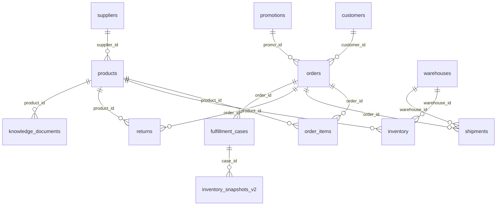

# Fiction Retail Unified SQLite Schema

**Release:** `fiction-retail-unified-v1.0.0` on the `codex/unified-nov2026` branch. The standalone runtime is `data/fiction_retail.sqlite`. It contains 27 business tables: ten copied from the unchanged DataHub source and 17 from the synthetic v0.4 extension. Table counts below describe the released business rows; `metadata` gains transformation keys. All dates are fictional and rebased by 916 days. See [the data contract](DATA_CONTRACT.md) for interpretation and [the source audit](SOURCE_DB_AUDIT.md) for retained anomalies.



The diagram shows representative enforced FKs. A return has no `order_item_id`; its exact returned line cannot always be inferred. The builder also checks that each fulfillment case's `order_item_id`, `order_id`, and `product_id` agree without inventing a composite key.

## Source-derived tables

Every logical source ID is now a declared `TEXT PRIMARY KEY`; existing ID values and business columns are preserved. Date fields remain ISO text, money remains SQLite `REAL`, and integer percentage discounts remain `INTEGER`.

| Table (rows) | Primary key | Columns |
|---|---|---|
| `customers` (50,000) | `customer_id` | `customer_id, name, email, phone, signup_date, country, state, city, customer_segment` |
| `orders` (150,000) | `order_id` | `order_id, customer_id, order_date, order_status, total_amount, payment_method, shipping_country, promo_id` |
| `order_items` (346,202) | `order_item_id` | `order_item_id, order_id, product_id, quantity, unit_price, discount_pct` |
| `products` (5,000) | `product_id` | `product_id, name, category, brand, price, weight_kg, supplier_id, sku` |
| `suppliers` (500) | `supplier_id` | `supplier_id, name, country, contract_start_date, status` |
| `inventory` (11,476) | `inventory_id` | `inventory_id, product_id, warehouse_id, quantity_on_hand, reserved_quantity, reorder_threshold, last_restocked_date` |
| `warehouses` (15) | `warehouse_id` | `warehouse_id, name, city, state, country, capacity_units, opened_date` |
| `shipments` (119,936) | `shipment_id` | `shipment_id, order_id, warehouse_id, carrier, tracking_number, shipped_date, delivered_date, shipment_state` |
| `returns` (11,934) | `return_id` | `return_id, order_id, product_id, return_date, refund_amount, return_reason_code, processed_by` |
| `promotions` (200) | `promo_id` | `promo_id, promo_code, description, discount_pct, valid_from, valid_until, applies_to_category, max_uses, status` |

`products.sku` is the only new source-derived business column: a unique, non-empty, non-null Fiction-generated identifier. Its deterministic formula is `FR-` plus the first 16 uppercase hex characters of SHA-256(`product_id`). Foreign keys continue to use `product_id`.

## Extension-derived tables

The original extension keys, CHECK constraints and seven explicit indexes are retained. These rows remain synthetic scenarios; copying them into one database does not make them source observations.

| Table (rows) | Primary key | Columns |
|---|---|---|
| `teams` (4) | `team_id` | `team_id, name` |
| `employees` (24) | `employee_id` | `employee_id, team_id, display_name, role, hire_date, active` |
| `sales_opportunities` (564) | `opportunity_id` | `opportunity_id, employee_id, customer_id, order_id, opened_at, closed_at, status, provenance` |
| `sales_activities` (1,008) | `activity_id` | `activity_id, opportunity_id, employee_id, occurred_at, activity_type, outcome, provenance` |
| `sales_targets` (24) | `(employee_id, month, metric_key)` | `employee_id, month, metric_key, target_value_usd, provenance, period_start, period_end` |
| `fulfillment_cases` (100) | `case_id` | `case_id, order_id, order_item_id, product_id, request_qty, assigned_warehouse_id, case_date, provenance` |
| `fulfillment_events` (200) | `event_id` | `event_id, case_id, event_time, event_type, provenance` |
| `inventory_observations` (126) | `observation_id` | `observation_id, case_id, product_id, warehouse_id, observed_at, on_hand, reserved, provenance` |
| `warehouse_eligibility` (200) | `(case_id, warehouse_id)` | `case_id, warehouse_id, eligible, reason_code, provenance` |
| `fulfillment_policies` (1) | `policy_id` | `policy_id, policy_summary, requires_manager_approval, provenance` |
| `operational_events` (400) | `event_id` | `event_id, case_id, event_type, occurred_at, recorded_at, source_system, provenance` |
| `inventory_snapshots_v2` (216) | `snapshot_id` | `snapshot_id, case_id, product_id, warehouse_id, observed_at, received_at, on_hand, reserved, source_system, provenance` |
| `inventory_movements_v2` (22) | `movement_id` | `movement_id, case_id, product_id, warehouse_id, occurred_at, delta_on_hand, delta_reserved, reason, provenance` |
| `product_enrichment` (50) | `product_id` | `product_id, source_name, category, synthetic_display_name, product_type, synthetic_specs, compatibility_note, provenance, curated_list_price_usd, curated_shipping_weight_kg, catalog_effective_from, catalog_effective_to` |
| `product_pricing_constraints` (20) | `product_id` | `product_id, unit_cost_usd, min_margin_bps, max_discount_bps, effective_from, effective_to, policy_id, provenance` |
| `knowledge_documents` (5,003) | `document_id` | `document_id, product_id, policy_id, kind, relative_path, sha256, provenance` |
| `metadata` (20 → 34) | `key` | `key, value` |

`period_start` and `period_end` are the two new extension metadata columns. The translated target period is `[2026-10-04, 2026-11-03)`; `month='2026-10'` is its start-month cohort label, not a calendar-month window. The decimal-valued `curated_list_price_usd`, `curated_shipping_weight_kg`, `unit_cost_usd` and `target_value_usd` remain decimal `TEXT` rather than floating-point estimates.

## Relationships and constraints

Source-derived FKs: `orders.customer_id → customers`, nullable `orders.promo_id → promotions`; `order_items.order_id → orders`, `order_items.product_id → products`; `products.supplier_id → suppliers`; `inventory.product_id → products`, `inventory.warehouse_id → warehouses`; `shipments.order_id → orders`, `shipments.warehouse_id → warehouses`; `returns.order_id → orders`, `returns.product_id → products`.

Cross-origin FKs added in the unified database: `sales_opportunities.customer_id → customers`, optional `order_id → orders`; `fulfillment_cases.order_id → orders`, `order_item_id → order_items`, `product_id → products`, `assigned_warehouse_id → warehouses`; product/warehouse references in `inventory_observations`, `inventory_snapshots_v2`, `inventory_movements_v2`, and `warehouse_eligibility`; `product_enrichment.product_id`, `product_pricing_constraints.product_id`, and nullable `knowledge_documents.product_id → products`. Existing extension FKs connect teams, employees, opportunities, activities, targets, cases and their events/snapshots.

The builder inserts parents before children with `PRAGMA foreign_keys=ON`, runs `PRAGMA foreign_key_check` and `PRAGMA integrity_check`, and rejects any orphan, duplicate PK/SKU, or case/line identity mismatch. SQLite requires [foreign-key enforcement to be enabled per connection](https://www.sqlite.org/foreignkeys.html); the unified source tables were rebuilt with declared keys because [ALTER TABLE does not add a primary-key constraint](https://www.sqlite.org/lang_altertable.html). No default `ON DELETE CASCADE` was added. A policy reference is checked against published policy documents and effective intervals rather than forced into a false FK spanning distinct policy tables.

## Indexes and query shape

Declared PK/UNIQUE constraints create their own SQLite indexes. The seven inherited extension indexes serve opportunity/employee/close time, activity/opportunity/time, case/product, observation/case, snapshot/case/warehouse/time, operational event/case/time, and knowledge document/product/kind lookups. The new indexes are:

| Index | Columns | Main lookup |
|---|---|---|
| `idx_orders_customer` | `orders(customer_id)` | Customer order history |
| `idx_orders_date_status` | `orders(order_date, order_status)` | Period-only filters and top sellers |
| `idx_orders_status_date_amount` | `orders(order_status, order_date, total_amount)` | Covering delivered-value aggregate |
| `idx_orders_promo` | `orders(promo_id)` | Promotion reconciliation |
| `idx_order_items_order_product` | `order_items(order_id, product_id)` | Order lines and eligible items |
| `idx_order_items_product` | `order_items(product_id)` | Product sales |
| `idx_inventory_product_warehouse` | UNIQUE `inventory(product_id, warehouse_id)` | Product stock and pair integrity |
| `idx_inventory_warehouse` | `inventory(warehouse_id)` | Warehouse totals |
| `idx_shipments_order` | `shipments(order_id)` | Order shipment |
| `idx_shipments_tracking` | `shipments(tracking_number)` | Tracking lookup |
| `idx_returns_order_product` | `returns(order_id, product_id)` | Return reconciliation |
| `idx_sales_opportunities_customer` | `sales_opportunities(customer_id)` | Customer opportunities |

The source has no declared indexes; compare actual [SQLite `EXPLAIN QUERY PLAN`](https://www.sqlite.org/eqp.html) and timings before claiming a speedup. The released database is a historical/synthetic snapshot, so any 4-second application timeout must be evaluated with representative SQL and hardware.

### Local index benchmark

Measured on Windows 11 with Python 3.14.8 / SQLite 3.50.4. The baseline was a copy of the same unified data with all **19 explicit indexes** removed; PK/UNIQUE auto-indexes remained. SQLite automatic indexes used their default setting. Each number is the median of three warmed executions, in milliseconds, with identical parameters and row counts. These are local query latencies, not a service-level guarantee.

| Query | Baseline ms | Release ms | Rows returned |
|---|---:|---:|---:|
| Order by PK | 0.030 | 0.034 | 1 |
| Product by SKU | 0.027 | 0.024 | 1 |
| Order → items → product | 94.533 | 0.034 | 2 |
| Inventory by product/warehouse | 1.472 | 0.031 | 1 |
| Shipment by order | 33.619 | 0.025 | 1 |
| Return by order/product | 3.010 | 0.024 | 1 |
| Case events → stock evidence | 0.084 | 0.041 | 4 |
| Product guide lookup | 1.096 | 0.029 | 1 |
| Recorded delivered-order value, translated target period | 32.282 | 1.541 | 1 |
| Top-selling products, translated target period | 1,863.166 | 864.109 | 10 |

For the order-line lookup, `EXPLAIN QUERY PLAN` changed from `SCAN i` to `SEARCH i USING INDEX idx_order_items_order_product`. The delivered-value query changed from `SCAN orders` to a covering search on `idx_orders_status_date_amount`; top sellers changed from an order-item scan to date-filtered orders joined through `idx_order_items_order_product`. The date-first and status-first order indexes were both retained: testing the status-first index alone made top sellers take 22,752 ms, above the 4-second target, while both indexes brought that query below one second on this machine. The PK lookup was effectively unchanged. Larger ranges, cold caches and application overhead remain unmeasured.

## Query and inspect

```sql
SELECT p.product_id, p.sku, e.synthetic_display_name,
       e.curated_list_price_usd, k.relative_path
FROM products p
JOIN knowledge_documents k ON k.product_id=p.product_id
  AND k.kind='product_guide'
LEFT JOIN product_enrichment e ON e.product_id=p.product_id
  AND e.catalog_effective_from<=:as_of AND :as_of<e.catalog_effective_to
WHERE p.sku=:sku;

PRAGMA table_info('products');
PRAGMA foreign_key_list('fulfillment_cases');
PRAGMA index_list('orders');
PRAGMA foreign_key_check;
PRAGMA integrity_check;
```

There is no runtime `ATTACH DATABASE` dependency. `knowledge_documents.relative_path` is relative to `knowledge/` and its SHA-256 must match the exact Markdown bytes. Product and RAG metadata carry both product ID and SKU; only 50 products have a dated curated offer.
